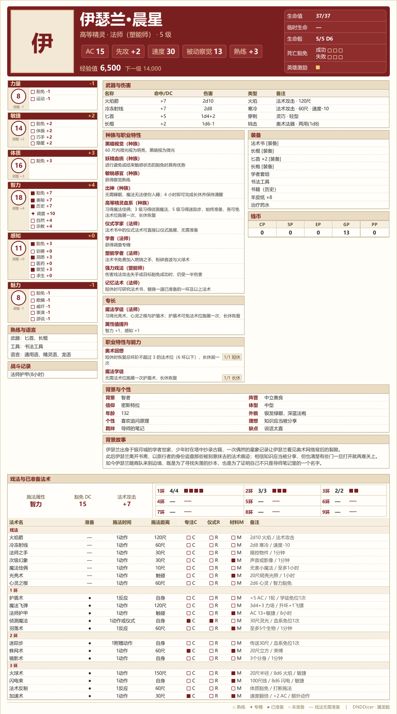
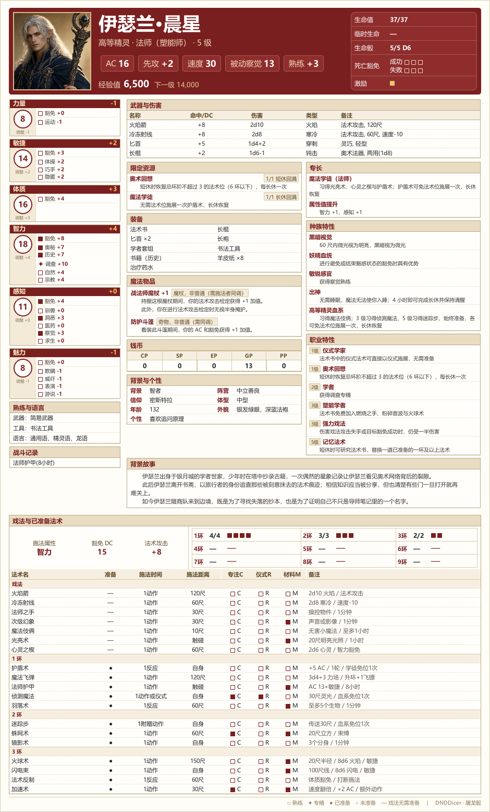

# 角色卡录入

角色卡是检定的基础，录入角色卡后，可以方便地使用 `.力量检定`、`.敏捷豁免`、`.隐匿检定` 等命令进行检定与豁免，骰娘会自动代入卡上的加值。

## 先确定属性

在录入角色卡之前，首先要确定属性值。DND 建卡的属性值有许多种确定方法，骰娘可以帮你掷骰子来确定属性值。

### 掷点法
```text
.dnd [次数]
.dndx [次数]
```

两者都按 4D6K3 生成六项属性（每项掷 4 颗 D6、去掉最低的一颗后求和），区别只在结果**是否绑定属性名**：

| 命令 | 输出 | 适用场景 |
| --- | --- | --- |
| `.dnd` | 六项数值的**降序**列表（只出数值，不绑定） | 想自行把数值分配给六属性 |
| `.dndx` | 数值按固定顺序**直接绑定属性名**（不排序） | 掷出即定，不可自行分配 |

命令后可跟**次数**与**原因**：`.dnd2` 一次掷两组（上限 20），原因会写进标题。DM 给客串 NPC 掷点：

::: chat
白鸦 | .dnd
屠龙骰 | 白鸦 DND人物作成:
74 : [18, 14, 13, 11, 10, 8]
白鸦 | .dnd2 替补
屠龙骰 | 白鸦 DND人物作成——替补:
70 : [17, 14, 13, 12, 7, 7]
76 : [18, 15, 14, 12, 9, 8]
:::

读法：`74` 是六项合计，`[18, 14, …]` 是六项数值的降序列表，自行挑六个数字分配给属性即可。

`.dndx` 的顺序与建卡器的六属性栏完全一致，但建卡器需要填写最终的属性值，需要你手动根据种族或背景来加成后再填入。小鹿试掷：

::: chat
小鹿 | .dndx
屠龙骰 | 小鹿 DND人物作成(属性绑定):
75 : 力量 9、敏捷 15、体质 15、智力 15、感知 12、魅力 9
:::

## 到网页建卡器建卡

[网页建卡器](./card-builder.md)帮你把整张卡生成成可以复制的命令，不需要手写卡文本。

> 请放心：网页建卡器完全在你浏览器本地运行，内容不会上传任何服务器。

1. 打开[网页建卡器](./card-builder.md)，先填卡名，再从上到下填表。卡名是卡库里的标识（≤20 字符，不能含空格、`$`、`@`），与卡内的角色名分开。
2. 根据规则书，从上到下依次填写你的角色卡。
3. 选择图片裁切立绘，之后你能在角色卡预览中看到你的完整卡面。
4. 核对无误后，点击「复制整卡命令」，直接粘贴发送到你的跑团群聊。
5. 在跑团群中发送 `.角色卡` 给 DM 和群友查看你的角色卡内容。

> 如果卡面文本太长，为避免在群聊刷屏，推荐**在私聊新建角色卡**：
> 1. 点击「复制整卡命令」，粘贴发送到你和骰娘的私聊对话框。
> 2. 使用 `.角色卡绑定 <卡名> <群号>` 将此角色卡绑定到你的跑团群。
> 3. 在跑团群中发送 `.角色卡` 给 DM 和群友查看你的角色卡内容。

## 卡库与常用命令

一个 QQ 账号的卡库最多 10 张卡；每位玩家在每个群最多绑定一张，且推荐**一张卡只绑定一个群**。

::: details 一卡绑多群会怎么样？
骰娘不会阻止你把同一张卡绑到第二个群，**但千万不要同时使用它们**，因为生命值、激励、死亡豁免、法术位、限定资源等数据都记在卡上，同一张卡在两个群同时使用会读写同一份数据，一个团的消耗与状态会带到另一个团。

如果确有需要用同一张卡同时跑两个团，请**另建一张卡名不同、内容相同的卡**，分别绑定到各自的群。
:::

### 新建

```text
.角色卡新建 <卡名> <完整卡内容>
```

不建议手写此命令，推荐直接使用[网页建卡器](./card-builder.md)建卡并复制发送。

此命令支持在群聊和私聊发送，均会写入你的卡库。由于角色卡文本一般很长，推荐**在私聊中新建角色卡**。

### 绑定
```text
群聊：.角色卡绑定 <卡名>
私聊：.角色卡绑定 <卡名> <群号>
```
若你直接在群聊中发送 `.角色卡新建` 命令，那么可忽略此条命令，骰娘会自动把新卡绑定到本群。

若你之前在私聊中新建角色卡，需要用这条命令把卡绑定到跑团群。

群聊发送时只写卡名，私聊发送时卡名与群号都要写；卡名不能省略。

### 修改
```text
.角色卡修改 <卡名> <段条目>
```

修改角色卡部分条目时无需重发整张卡。在网页建卡器里改好某一段后，点击该字段旁的「复制本段」，然后复制给骰娘即可；也可以一次写多个段。

| 写法 | 行为 |
| --- | --- |
| `.角色卡修改 <卡名> <段条目>` | 只覆盖写到的段，未提到的段保持原样 |
| 段名后不写内容 | 清空该段（角色名、等级、属性不能清空） |
| 一次写多个段 | 逐段覆盖；任何一段非法，整条命令拒绝，卡不变 |
| 群聊省略卡名 | 改本群当前绑定的卡；写卡名时必须是本群绑定卡 |
| 私聊省略卡名 | 仅当卡库只有一张卡时可用；多张必须写卡名 |

如要新增第二张卡，请用 `.角色卡新建`，不要用 `.角色卡修改`。

### 查看卡与状态

| 写法 | 地点 | 行为 |
| --- | --- | --- |
| `.角色卡` | 群聊/私聊 | 群聊看本群绑定卡；私聊看本人卡（多张需带卡名） |
| `.角色卡 @玩家` | 群聊 | 查看他人的本群绑定卡 |
| `.角色卡 角色名` | 群聊 | 查看他人的本群绑定卡 |
| `.角色卡 [卡名]` | 私聊 | 查看本人卡，卡库多张时需带卡名 |
| `.角色卡导出 [@玩家\|角色名\|卡名]` | 私聊/群聊 | 导出角色卡的文字版本 |

::: chat
小满 | .角色卡
屠龙骰 | [图片]
小满 | .角色卡 @阿茶
屠龙骰 | [图片]
:::

::: chat
老猫 | .状态
屠龙骰 | HP:43/43
生命骰:5/5 D8
:::

`.状态` 查看他人同样支持 `@玩家` 与角色名；角色名命中 NPC 条目时会提示「是NPC条目，没有角色卡」。

### 列表、改名与解绑

| 写法 | 地点 | 说明 |
| --- | --- | --- |
| `.角色卡改名 旧名 新名` | 私聊/群聊 | 只修改卡名，不改卡内角色名；群聊只能改本群绑定卡 |
| `.角色卡列表` | 私聊/群聊 | 列出本人卡库（卡名、角色名、等级与职业）、已绑定群与当前群标记 |
| `.角色卡绑定 <卡名>` / `<卡名> <群号>` | 私聊/群聊 | 群聊写卡名绑本群；私聊写卡名与群号 |
| `.角色卡解绑 [群号]` | 私聊/群聊 | 群聊可省略群号 |

绑定新卡会替换本群原来的绑定。把同一张卡绑到第二个群时，骰娘会照常执行，并在回复末尾提醒「同一张卡绑定多个群聊可能造成数据冲突！」。

### 清除
```text
.角色卡清除 卡名 确认
```

删除角色卡用 `.角色卡清除 卡名 确认`；不带 `确认` 时只回一句确认提示。

**已经绑定到群的卡不能直接删**：先在各个已绑定的群用 `.角色卡解绑`（或在私聊用 `.角色卡解绑 <群号>` 逐个解除），再删除。删除会连同立绘一起清理。

小鹿建了一张名为「角色卡1」的临时卡，试完后解绑并删掉：

::: chat
小鹿 | .角色卡解绑
屠龙骰 | 已解除本群的角色卡绑定
小鹿 | .角色卡清除 角色卡1 确认
屠龙骰 | 角色卡「角色卡1」已删除
:::

## 卡图与立绘

### 卡图

图片卡需要骰主安装渲染依赖并开启角色卡图开关；未开启时 `.角色卡` 直接输出文字卡，开启但渲染依赖缺失或渲染失败时回退文字卡，并在末尾提示联系骰主解决。



> 此示例图基于 5r 规则构建角色卡，由真实渲染器使用模板示例卡生成，仅用于展示版式；实际卡面以骰娘输出为准。

::: details 基于 5e 规则构建的示例卡

:::

### 立绘

立绘是每张卡自己的图片，设置后会放进角色卡图左上角的方框。

| 场景 | 操作 | 命令 | 说明 |
| --- | --- | --- | --- |
| 群聊 | 查看 | `.立绘` | 看自己在本群绑定的卡 |
| 群聊 | 查看 | `.立绘 @玩家` / `.立绘 角色名` | 看别人（或自己）在本群绑定的卡；对方的卡需绑定本群 |
| 私聊 | 查看 | `.立绘 [卡名]` | 看自己的卡，卡库只有一张时可省略卡名 |
| 群聊 | 设置 | `.立绘 [卡名]` + 图片 | 只能改本群绑定卡；卡名可省略，写了就必须是本群绑定卡的名字 |
| 私聊 | 设置 | `.立绘 [卡名]` + 图片 | 按卡名选卡，卡库只有一张时可省略卡名 |

插件按原图保存，不压缩、不缩放、不裁切；建议使用方形图片，卡面立绘框是 1:1。不想自己裁比例时，可以用[网页建卡器](./card-builder.md#立绘)里的裁切工具裁成 512×512 再发送。

支持 PNG / JPG / WebP，单张不超过 4 MB。一次发多张时只保留第一张。没有立绘的角色卡会显示姓名首字占位。

立绘属于当前卡；`.角色卡清除 <卡名> 确认` 会连同立绘一起删除，`.角色卡修改` 改段不会丢失已设置的立绘。

示例团的洛恩与薇拉都还没有设置立绘，查看时只得到提示：

::: chat
小满 | .立绘
屠龙骰 | 你还没有设置立绘，发送图片并附带 .立绘 即可设置
小满 | .立绘 @阿茶
屠龙骰 | 「薇拉」还没有设置立绘

注：以下内容发生在私聊对话框

小满 | .立绘
屠龙骰（私聊） | 你还没有设置立绘，发送图片并附带 .立绘 即可设置
:::

## 快速记录

这三段都有专门命令直接改卡，不需要整段重写，其他段（包括经验、物品、武器等）不会被覆盖。

### 英雄激励

2024 / 5r 群称「英雄激励」，2014 / 5e 群称「激励」；称呼随[群级规则版本](./rules-version.md)变化，数据仍记在卡上，值只有 `有` / `无`，没写过时显示「未记录」。

- `.激励` 或 `.激励 状态`：查看本人当前状态；
- `.激励 +` / `.激励 -`：获得 / 消耗；已有激励时不能叠加，没有时不能消耗；
- `.激励 给予 <目标>`：把本人的激励转赠给 `@玩家` 或本群角色名，目标须已绑定角色卡且当前没有激励；名称精确优先、其次子串，多候选只列清单不猜。

示例团薇拉获得一次激励并转赠给塔莉：

::: chat
阿茶 | .激励
屠龙骰 | 薇拉的英雄激励：未记录
阿茶 | .激励 +
屠龙骰 | 薇拉获得了英雄激励。
阿茶 | .激励 给予 @老猫
屠龙骰 | 薇拉将英雄激励转赠给塔莉。
老猫 | .激励
屠龙骰 | 塔莉的英雄激励：有
:::

### 战斗记录

战斗记录用来记专注中的法术、中毒、短暂状态等临时信息，最多 20 条、每条 60 字。

- `.战斗记录` 按序号列出全部条目；
- `.战斗记录 +文本` 追加一条，文本含 `;` 时一次追加多条；
- `.战斗记录 -序号` 按 1 起的序号删除，多个序号用 `/` 或 `;` 分隔（如 `-1/3`）；
- `.战斗记录 清` 清空全部。

老猫先记一条专注，再追加中毒与目盲，最后查看列表：

::: chat
老猫 | .战斗记录 +祝福术(专注,3轮)
屠龙骰 | 已添加 1 条战斗记录：祝福术(专注,3轮)（当前共 1 条）
老猫 | .战斗记录 +中毒; 目盲
屠龙骰 | 已添加 2 条战斗记录：中毒；目盲（当前共 3 条）
老猫 | .战斗记录
屠龙骰 | 战斗记录（3 条）：
1. 祝福术(专注,3轮)
2. 中毒
3. 目盲
:::

### 钱币收支

- `.钱币` 查看 CP / SP / EP / GP / PP 五种币值；
- `.钱币 +20GP-5SP` 紧凑写法，大小写不敏感，可连续写多条，按书写顺序结算；操作之间允许空格；
- 加法只加指定币种，**不做汇率换算**；
- 减法先扣指定币种，不足时按「最接近的更高币种优先」破开（CP 用 SP/EP/GP/PP，SP 用 EP/GP/PP，EP 用 GP/PP，GP 用 PP），更高币种仍不足才用更低币种按面值抵扣；换算率固定 `1 PP = 10 GP`、`1 GP = 10 SP = 100 CP`、`1 EP = 5 SP`；
- 整条命令原子：任一条减法总价值不足就整条拒绝，不部分扣款；
- 结算行只列出**数值发生变化**的币种。

老猫先看余额，收 20 GP、花 5 SP，再付 19 GP：

::: chat
老猫 | .钱币
屠龙骰 | 钱币：CP 0；SP 0；EP 0；GP 0；PP 0
老猫 | .钱币 +20GP-5SP
屠龙骰 | 钱币：+20GP，-5SP
SP 不足：拆 1 GP → +10 SP，扣 5 SP，余 5 SP
GP:0 → 19；SP:0 → 5
老猫 | .钱币 -19GP
屠龙骰 | 钱币：-19GP
GP:19 → 0
:::

## 相关命令

| 命令 | 用法 | 说明 |
| --- | --- | --- |
| `.角色卡` | `.角色卡`、`.角色卡 卡名`、`.角色卡 @玩家` | 群聊看本群绑定卡；私聊按卡名看本人卡（开启角色卡图时出图） |
| `.角色卡导出` | `.角色卡导出`、`.角色卡导出 @玩家` | 输出文字版角色卡（始终文字） |
| `.角色卡新建` | `.角色卡新建 <卡名>` + 建卡器生成的整卡内容 | 新建卡；群聊自动绑定本群 |
| `.角色卡修改` | `.角色卡修改 [卡名] <段条目>` | 只覆盖提到的段；空段清空 |
| `.角色卡改名` | `.角色卡改名 <旧名> <新名>` | 修改卡库标识（不改卡内角色名） |
| `.角色卡列表` | `.角色卡列表` | 查看本人卡库与已绑定群 |
| `.角色卡绑定` | `.角色卡绑定 <卡名>` / `.角色卡绑定 <卡名> <群号>` | 群聊绑本群；私聊按群号绑（推荐一卡一群，绑到其他群会提醒） |
| `.角色卡解绑` | `.角色卡解绑` / `.角色卡解绑 <群号>` | 解除本群 / 指定群绑定 |
| `.角色卡清除` | `.角色卡清除 <卡名> 确认` | 删除未绑定的卡（连同立绘） |
| `.立绘` | 群聊 `.立绘` / `.立绘 @玩家\|角色名`；私聊 `.立绘 [卡名]` | 查看自己或他人的立绘（群聊看本群绑定卡） |
| `.立绘 [卡名]` + 图片 | 群聊只能改本群绑定卡；私聊按卡名 | 设置立绘（原图直存，≤4 MB） |
| `.状态` | `.状态`、`.状态 @玩家`、`.状态 卡名` | HP 与生命骰摘要 |
| `.激励` | `.激励`、`.激励 +`、`.激励 -`、`.激励 给予 @玩家` | 英雄激励的查看、获得、消耗与转赠 |
| `.战斗记录` | `.战斗记录`、`.战斗记录 +文本`、`.战斗记录 -序号`、`.战斗记录 清` | 战斗记录的查看、追加、删除与清空 |
| `.钱币` | `.钱币`、`.钱币 +20GP-5SP` | 查看钱币与紧凑收支 |
| `.dnd` / `.dndx` | `.dnd`、`.dnd2 原因` | 4D6K3 掷点；`.dndx` 绑定属性名 |

接下来：[检定与豁免](./checks.md)：用这张卡自动代入加值掷检定。
